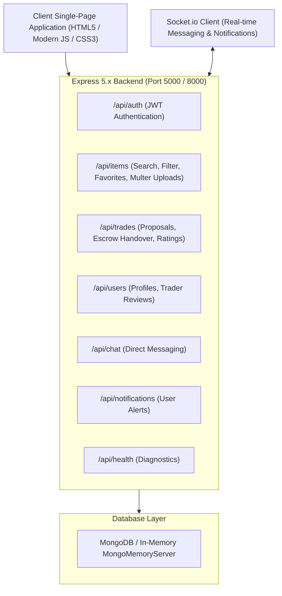

# 🇪🇺 BarterHub Europa — L'Art de l'Échange

> **Premier European Peer-to-Peer Marketplace for Barter (Troc), Direct Purchase & Gear Rental**

[](#)
[](#)
[](#)
[](#)

BarterHub Europa is a full-stack, real-time peer-to-peer exchange platform tailored for European creators, collectors, artisans, and professionals across Paris, Berlin, Amsterdam, Milan, Barcelona, Vienna, and beyond. Trade rare items without money, purchase pre-loved treasures in € Euros, or rent equipment by the day.

---

## 🌐 Quick Access Links

| Interface | URL | Description |
| :--- | :--- | :--- |
| **Primary Web App** | [http://localhost:5000](http://localhost:5000) | Full SPA Frontend & Real-time WebSockets |
| **Alternative Port** | [http://localhost:8000](http://localhost:8000) | Convenience mirror port |
| **API Health Check** | [http://localhost:5000/api/health](http://localhost:5000/api/health) | Live JSON health check status |
| **API Endpoints** | [http://localhost:5000/api](http://localhost:5000/api) | RESTful API base route |

---

## 🚀 Key Features

### 1. 🔄 Tri-Mode European Listings
- **Barter / Troc (Trade)**: Cashless 1-to-1 or multi-item bartering with exchange wishlists.
- **🏷️ Direct Sale**: Sell pre-loved items in Euros (€) with condition grading.
- **⏱️ Daily Gear Rental**: Rent tools, audiovisual equipment, and sports gear with daily rates and security deposits.

### 2. 🛡️ 4-Stage European Escrow & Handover Tracker
- **Stage 1 (Proposal)**: Select offered items and requested items with custom negotiation message.
- **Stage 2 (Agreed)**: Receiver reviews and accepts trade terms.
- **Stage 3 (Escrow Handover)**: Both parties confirm item shipment, tracking number, or local hand-off.
- **Stage 4 (Completed & Transferred)**: Automatic item ownership reassignment in MongoDB and trade history logging.

### 3. ⭐ European Reputation & Review System
- Post-trade 1–5 star reviews with verified trader comments.
- Public trader profiles displaying completed trade count, member since, rating distribution, and written feedback.

### 4. 💬 Real-Time Chat & Live Notifications
- Real-time instant messaging powered by **Socket.io**.
- In-app notification center for new proposals, status changes, likes, and ratings.
- Unread message counters and typing indicators.

### 5. 🔍 Advanced European Search & Filtering
- Filter by category, condition, and listing model (Barter, Sale, Rental).
- **Location Filter**: Paris 🇫🇷, Berlin 🇩🇪, Amsterdam 🇳🇱, Milan 🇮🇹, Barcelona 🇪🇸, Vienna 🇦🇹.
- **Price / Value Range**: Minimum and maximum Euro (€) filters.
- **❤️ Favorites & Wishlist**: Save items with one click and access them from the navigation bar.

---

## ⚡ Quick Demo Accounts

The application automatically seeds a rich European community on first launch. You can one-click sign in using the **Quick Demo Login** bar at the top of the interface:

| Trader | City | Email | Password | Speciality |
| :--- | :--- | :--- | :--- | :--- |
| **🇫🇷 Julien** | Paris, France | `julien@barterhub.eu` | `password123` | Leica collector & photographer |
| **🇩🇪 Elena** | Berlin, Germany | `elena@barterhub.eu` | `password123` | Synthesizers & vinyl producer |
| **🇳🇱 Lars** | Amsterdam, Netherlands | `lars@barterhub.eu` | `password123` | Woodworking & cycling gear |
| **🇮🇹 Sofia** | Milan, Italy | `sofia@barterhub.eu` | `password123` | Vintage fashion & espresso |
| **🇪🇸 Mateo** | Barcelona, Spain | `mateo@barterhub.eu` | `password123` | Ceramic art & sound systems |
| **🇦🇹 Demo** | Vienna, Austria | `demo@barterhub.eu` | `password123` | Europa Verified Demo Account |

---

## 🛠️ Architecture



---

## 💻 Tech Stack

- **Backend Runtime**: Node.js v18+ / Express 5.3
- **Database**: MongoDB with Mongoose 9.x + automatic fallback to `mongodb-memory-server`
- **Real-Time Layer**: Socket.IO 4.8
- **Authentication**: JSON Web Tokens (`jsonwebtoken`) + `bcryptjs`
- **File Uploads**: `multer` with local disk storage
- **Frontend**: Vanilla ES6+ SPA, CSS3 custom design tokens (Playfair Display + Plus Jakarta Sans)
- **Testing**: Built-in Node.js native test runner (`node:test`, `node:assert`)

---

## 🏁 Quickstart Guide

### 1. Clone & Install Dependencies
```bash
npm install
```

### 2. Environment Variables
Copy `.env.example` to `.env` (defaults are preconfigured):
```ini
PORT=5000
MONGODB_URI=mongodb://localhost:27017/barterdb
JWT_SECRET=barter_super_secret_jwt_key_2024
NODE_ENV=development
CLIENT_URL=http://localhost:5000
```
> **Note**: If a local MongoDB instance is not detected, BarterHub automatically spins up an in-memory database (`mongodb-memory-server`) with European sample seed data!

### 3. Start Server
```bash
npm start
```
Open **[http://localhost:5000](http://localhost:5000)** in your browser.

### 4. Run Automated Test Suite
```bash
npm test
```

---

## 📡 API Reference Summary

| Method | Endpoint | Auth | Description |
| :--- | :--- | :---: | :--- |
| `GET` | `/api/health` | No | Server diagnostic and database status |
| `POST` | `/api/auth/register` | No | Register new user account |
| `POST` | `/api/auth/login` | No | Login and obtain JWT token |
| `GET` | `/api/auth/me` | Yes | Retrieve current logged-in profile |
| `GET` | `/api/items` | No | Browse items with text search, categories, and city filters |
| `GET` | `/api/items/user/favorites`| Yes | Get items saved to user's favorites |
| `POST` | `/api/items` | Yes | Create new listing (Barter, Sale, Rent) |
| `POST` | `/api/items/:id/like` | Yes | Toggle like / favorite on an item |
| `GET` | `/api/trades` | Yes | List active and historical trades for current user |
| `POST` | `/api/trades` | Yes | Create a trade proposal with offered & requested items |
| `PUT` | `/api/trades/:id/accept` | Yes | Accept trade terms |
| `PUT` | `/api/trades/:id/escrow` | Yes | Update escrow handover state and confirm receipt |
| `PUT` | `/api/trades/:id/complete`| Yes | Complete trade and transfer item ownership |
| `POST` | `/api/trades/:id/rate` | Yes | Submit 1–5 star rating and review |
| `GET` | `/api/users/:id/reviews` | No | Fetch completed trade reviews for a trader |

---

## 📄 License

ISC License. Built for European peer-to-peer exchange.
